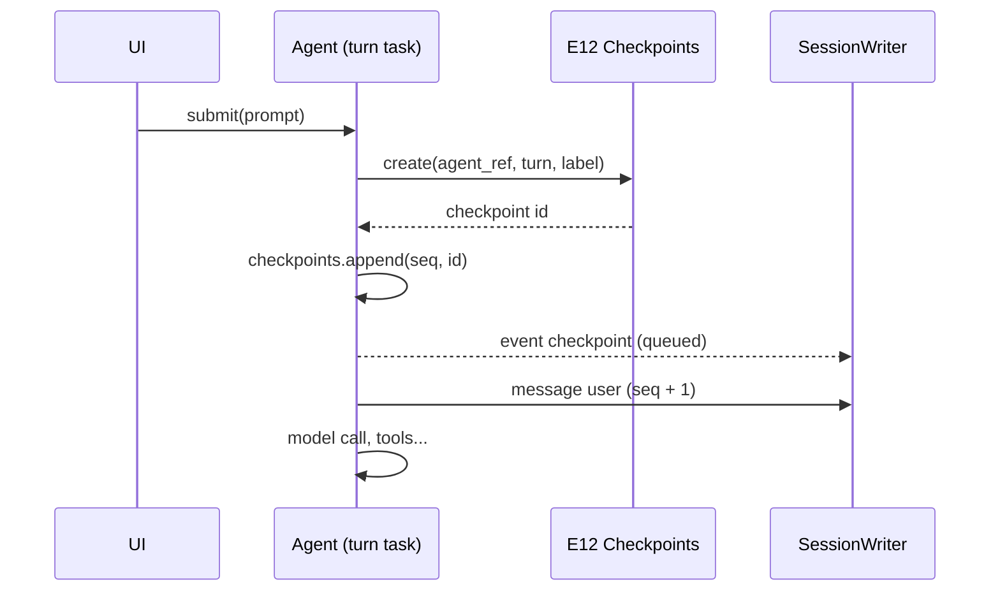
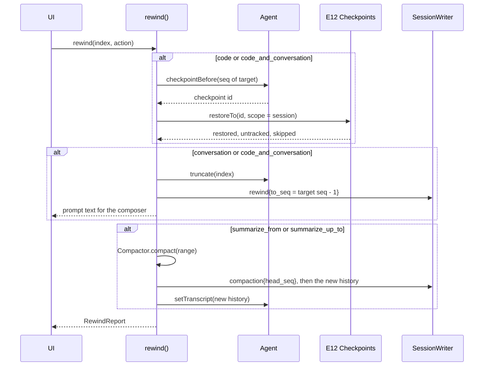

# zg_ai architecture: sessions, resume and rewind

This page covers how an agent's conversation is persisted and brought back,
and the contract with E12 checkpoints that rewind depends on. The session
file format itself is in [session-format.md](session-format.md).

## Pieces

| Module | Role |
| --- | --- |
| `loop/Agent.zig` | One conversation. Holds the transcript, the session sequence number of each message (`seqs`) and the checkpoints taken at the start of user turns. |
| `session/writer.zig` | Appends records. Receives committed messages through the `SessionLog` seam, and usage and checkpoint events through a queued bus subscriber. |
| `session/loader.zig` | Reads a file tail-first or in full, repairs a torn tail, synthesizes results for interrupted tool calls. |
| `session/fork.zig` | Creates forks and loads parent chains. |
| `session/resume.zig` | Rebuilds an agent from a session. |
| `session/rewind.zig` | Rewinds the conversation, the code, or both, or summarizes part of the conversation. |
| `session/index.zig` | The per-workspace session index (`index.zon`), with search, retention, titles and export beside it. |

Sequence numbers are shared: a message record carries the bus sequence number
of its `message_committed` event, and a resumed agent's bus continues after the
highest number in the file (`Bus.startAt`). Records therefore never reuse a
number, which is what lets `rewind{to_seq}` and `compaction{head_seq}` select
records by number rather than by position in the file.

## E12 checkpoint contract

E12.F04 provides checkpoints. zg_ai depends only on two calls, both reached
through vtables, so E12 can land later without changing the loop:

```zig
// At the start of each turn triggered by a user prompt (loop/deps.zig).
zg_review.Checkpoints.create(origin: zg_ai_proto.AgentRef, turn: u32, label: []const u8) CheckpointId
// Never fails; under 1 ms. `label` is the first 80 bytes of the prompt's first line.

// On a code rewind (session/rewind.zig), awaited.
restoreTo(id, RestoreOptions{ .mode, .dry_run, .scope = .session }) !RestoreTicket
// Reports restored files, untracked changes and skipped paths.
```

The loop publishes a `checkpoint{id, turn, label}` event right before it
commits the user message. The session writer records it as a `checkpoint`
record, and the agent remembers `(seq, id)` so a rewind can find "the latest
checkpoint before message N". A resume restores these marks from the records.

Mid-turn steering messages get no checkpoint of their own (as in Claude Code).

## Turn start



## Rewind

`rewind(agent, to, action, focus, deps)` runs while the agent is idle. The
target must be a user prompt for the conversation actions.



Rewound records stay in the file and become inactive: readers drop message
records with `seq > to_seq` that come before the `rewind` record.

## Resume

1. Open the session (and its fork chain) tail-first until the latest
   compaction. A rewind that reaches before the loaded part triggers a full
   read.
2. Rebuild the state:
   - The history after the latest surviving compaction, without rewound
     messages.
   - The model from the header, then the latest `model_change` event, unless
     overridden.
   - The agent definition, re-resolved, with a warning when it no longer
     exists.
   - The permission mode from the latest `mode` event, with the E16 policy
     applied: bypass is never restored, and plan is restored unless forking.
3. Write `is_error` results for tool calls cut off by a crash, so the history
   stays valid when the conversation continues.
4. Create the agent with the session's id, load the transcript and
   checkpoints, and publish `status=idle`.

Background tasks that were started but not finished in the old process are
reported as notes. Session-scoped permission grants carry over only for an
in-process `/branch`.

## Forks

A fork is a new file with a header `parent{session, seq}` and a `title`
record. Records with `seq <= parent.seq` are read from the parent, which is
opened read-only, so forking a session that another process is writing works.
Chains are followed up to 32 parents. A fork that would make the chain deeper
copies its parent's prefix into its own file and marks the link
`materialized`.
